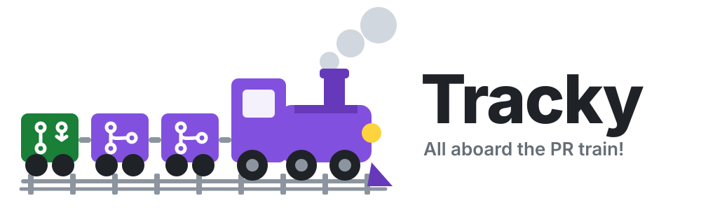

<p align="center">
  <picture>
    <source media="(prefers-color-scheme: dark)" srcset="docs/logo-dark.svg">
    
  </picture>
</p>

# Tracky

**All aboard the PR train! 🚂💨**

A feature on the RAMMP chair rarely lives in one repo. A new message starts in
[rammp-rtps](https://github.com/rammp-org/rammp-rtps), gets mirrored in
[rammp-interfaces-ros2](https://github.com/rammp-org/rammp-interfaces-ros2), and is used by
[RAMMP-mib-fw](https://github.com/rammp-org/RAMMP-mib-fw) and
[pace-hmi-fw](https://github.com/rammp-org/pace-hmi-fw). Those PRs have to be tested together
and merged in order, and the ones downstream have to be repointed at the upstream merge before
they can go in. Tracky does the bookkeeping for that, so you can do the work.

> Status: designed, not built. See [docs/design.md](docs/design.md). The order of work is at the
> bottom of that file.

## What a feature looks like

A **feature** is one thing you want on the chair, say `estop`, and the set of repos it touches.
Tracky turns it into a **train**: one issue, one branch and one draft PR per repo, in the
order they need to merge.

```
estop                                                   repoint: auto
  1  rammp-rtps#21             feat/21-estop     ✅ merged
  1  rammp-interfaces-ros2#30  feat/29-estop     ✅ merged into dev
  2  RAMMP-mib-fw#64           feat/60-estop     🔁 repointed to rtps 87b78ea · CI running
  2  pace-hmi-fw#26            feat/24-estop     🟢 ready: approve to merge
```

Step 1 merges first. When it does, Tracky moves step 2's `external/rammp-rtps` pointer to the
new rtps `main`, lets CI run, and switches on auto-merge. A person still approves every PR;
Tracky only removes the "come back later and press merge" part.

## Declaring a feature

Go to the Tracky page (GitHub Pages, link to come), fill in the form: name, the repos it
touches, a line per repo on what's needed there, and whether downstream PRs repoint
automatically. Submit opens a prefilled issue in this repo; confirm it and Tracky takes over:

1. An issue in each member repo describing what that repo needs.
2. A branch `feat/{issue}-{name}` in each repo, off its default branch (`main` for the firmware
   repos, `dev` for rammp-interfaces-ros2).
3. In repos that vendor rammp-rtps as a submodule, the pointer set to the rtps feature branch, so
   the whole feature builds and tests together before anything merges.
4. A draft PR per repo, from the repo's PR template, prefilled with the feature's note and
   `Closes #{issue}`.
5. A suggested merge order, from the dependencies Tracky can see. You can change it.

Then you develop on the branches as usual. Edit the PR descriptions freely; Tracky never
rewrites them.

## What Tracky does and does not do

Does:

- keeps a status comment on every PR in the train and a dashboard on the page
- suggests the merge order and warns if the one you set contradicts a dependency it can see
  (a repo that vendors another has to merge after it)
- after an upstream PR merges, repoints downstream branches and enables auto-merge, right away
  or when you say `/tracky repoint`, per feature
- comments on a Dependabot bump that a feature PR already carries

Does not:

- merge, approve, or review anything
- edit a PR description after scaffolding it
- replace Dependabot, CI, or branch protection; it relies on them

## Two kinds of issue in this repo

Tracky is developed here too, so its issue list holds both trains and its own work. A label
tells them apart, and Tracky only ever acts on the first kind:

| label      | what it is                                              | who makes it                |
|------------|---------------------------------------------------------|-----------------------------|
| `train`    | a feature being tracked: the umbrella issue of a train  | the declare form, always    |
| `tracky`   | a bug, idea or task for Tracky itself                   | the "Tracky itself" template |

Both come from issue templates, and blank issues are off, so every issue lands with the right
label. Tracky's workflows filter on `train`; an issue without it is invisible to the bot, and
`/tracky` comments on it get a polite "not a train" reply. Tracky's own development is ordinary
GitHub: an issue with `tracky`, a branch `feat/{issue}-{name}` by the same convention, a PR.

## Conventions it follows and expects

- Branches are `feat/{issue number}-{feature name}`; the issue is the one in that repo.
- Work goes to each repo's default branch.
- A PR's description carries `Closes #{issue}` so the issue closes on merge, and
  `Part of rammp-org/tracky#{feature}` so the feature issue links back.
- `Follows owner/repo#N` in a PR description overrides Tracky's suggested order for that PR.

## Talking to Tracky

On a feature issue or any PR in its train:

| comment                                     | effect                                         |
|---------------------------------------------|------------------------------------------------|
| `/tracky repoint`                           | move downstream pointers to the merged upstream |
| `/tracky order rtps, ros2, mib, hmi`        | set the merge order                            |
| `/tracky add RAMMP-mib-fw`                  | add a repo to the feature (issue, branch, PR)  |
| `/tracky status`                            | refresh the status comment now                 |

## Repo layout (planned)

```
tracky/           the bot: Python, stdlib + the GitHub API
.github/
  ISSUE_TEMPLATE/
    train.yml                  the declare form; labels the issue `train`
    tracky.yml                 bug, idea or task for Tracky itself; labels it `tracky`
    config.yml                 blank issues off
  workflows/                   scaffold, track, repoint, pages
site/             the GitHub Pages dashboard and declare form
docs/design.md    the design
```
